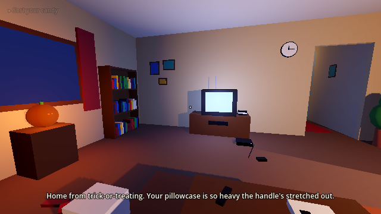
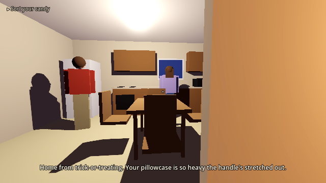
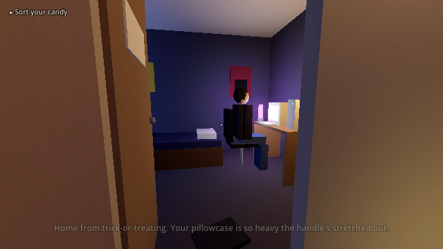
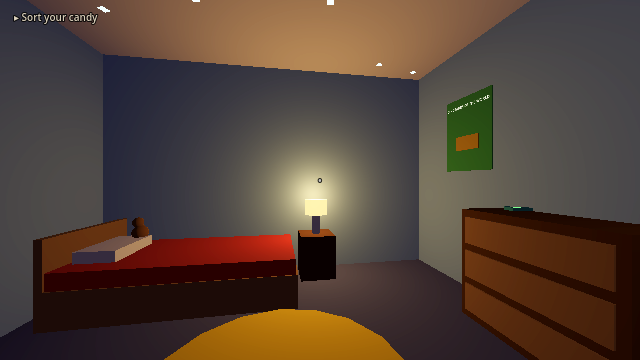
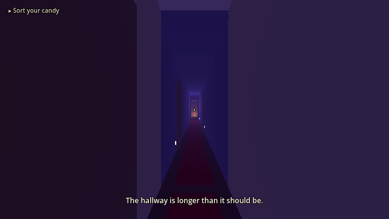
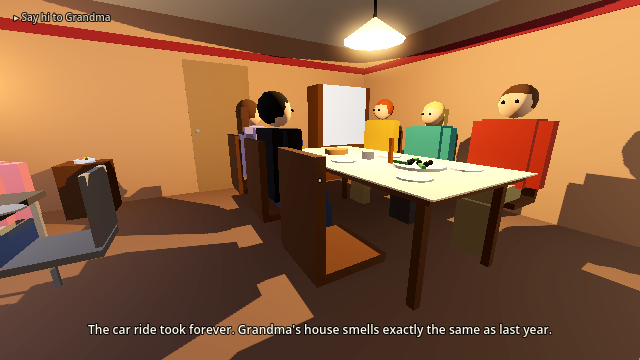

# Porch Lights

A short, first-person story game about growing up in the early 2000s, told through
the holidays from Halloween to Christmas. You play Leo, an 8-year-old. Your older
sibling Jamie is 15, and the dog is Biscuit. Everything is a little too big, the
grown-ups talk quietly in the kitchen, and every chapter ends with you falling asleep.



| | |
|---|---|
|  |  |
|  |  |
|  | |

## Play it
Open in **Godot 4.3+** (Import → select `project.godot`), then press F5.

WASD / arrows: move · Mouse: look · Shift: run · C or Ctrl: crouch
E or left click: interact · Esc: free the mouse (click to recapture)

## Story so far

**Chapter 1: October 31, Halloween.** Sort your candy. Pay the candy tax (and
overhear Mom and Dad worrying about Grandma). Turn off the porch light, and watch the
rest of the street go dark one house at a time. Show Jamie your haul and hang out in
their room until Mom calls bedtime. Fall asleep, and the hallway keeps going: Jamie's
door is open, the room is full of boxes, and at the very end there's a warm door
that smells like Grandma's kitchen.

**Interlude: 2:14 a.m., The Porch Light.** Something wakes you. Jamie's still up.
Mom's in the kitchen on the phone with Grandma, who can't sleep and keeps asking
about her porch light. Biscuit is whining at the front door. You turn the porch light
back on and let him out, and every porch light on the street is on again, at two in
the morning. One by one they go out, until only one is left: way at the end of the
street, the same orange as Grandma's.

**Chapter 2: November, Thanksgiving at Grandma's** (opening). Say hi to Grandma,
who sits down while she cooks now. Take your seat at the kids' table while Jamie
moves up to the big table. After dinner, the house goes quiet, and Grandma saves
you the first slice of pie.

**Chapter 3: November, The Long Drive Home.** The back seat, leftovers on your lap,
sodium streetlights sliding over the ceiling. Jamie lends you one earbud. Up front,
Mom talks quietly about Grandma's hands. You lean on the window and fall asleep, and
the car is gone: you're walking down a street where every porch light goes dark
behind you, toward the orange one at the end. Grandma's waiting on her porch. Then
Dad's carrying you inside.

**Chapter 4: December 18, The Last Week Before Winter Break.** Mom's been at
Grandma's since Sunday. Dad makes his famous (burnt) pizza and you set the table for
three. Mom calls from Grandma's: she's sleeping a lot. Dad takes the phone into the
garage and shuts the door. Jamie needs help finding the one dead bulb that keeps the
whole string dark. You fall asleep watching the Christmas special, and in the dream
it's snowing in the living room and Grandma calls: leave your porch light on
Christmas Eve, so she can find you.

**Planned:** Christmas Eve, Christmas morning and the quiet after.

## Project layout
- `scenes/chapter_1_halloween.tscn`, `scenes/chapter_2_thanksgiving.tscn`,
  `scenes/chapter_3_drive_home.tscn`, `scenes/chapter_4_winter_break.tscn`: levels
  (Chapter 4 inherits the Chapter 1 house and redecorates it in code)
  (the interlude plays in the Chapter 1 house, with the porch and street outside)
- `scripts/chapter.gd`: base class for chapters: `say()` dialogue (voiced automatically),
  `objective()`, `open_chapter()` title cards, `swing_door()`, `add_chatter()`, room-state swapping
- `scripts/chapter_1_halloween.gd`, `scripts/interlude_porch_light.gd`,
  `scripts/chapter_2_thanksgiving.gd`, `scripts/chapter_3_drive_home.gd`,
  `scripts/chapter_4_winter_break.gd`: story steps
- `scripts/car_ride.gd`: the family car at night, with the road sliding past
- `scripts/figure.gd`: builds people in code (Mom, Dad, Jamie, Grandma) to match the scenes
- `scripts/player.gd`: Leo's kid-height first-person controller (walk, run, crouch, sit, footsteps)
- `scripts/interactable.gd`: attach to any StaticBody3D. Set `prompt`,
  `memory_text`, `repeat_text` and `use_sfx` in the Inspector, or connect to `used`
- `scripts/trigger.gd`: invisible zone that fires when you walk in
- `scripts/hud.gd`: thoughts, dialogue, objective, fades, chapter cards
- `scripts/dog.gd`: Biscuit (naps, follows you, sits, whines, barks, growls)
- `scripts/street.gd`: the neighborhood outside, with porch lights that go out
- `scripts/tv_screen.gd`, `scripts/tv_show.gd`: the live picture on the TV. Drop an Ogg
  Theora video at `media/<channel>.ogv` (`special`, `commercial`, `dream`, `signoff`, `static`) to use real footage
- `scripts/audio.gd`: autoload `Audio` (music, sound effects, voices)
- `tests/`: automated playthroughs and a screenshot tool

Rendering is 640×360 scaled 2× for a low-res PS2-era look
(Project Settings → Display → Window), with a night sky, SSAO/SSIL and volumetric fog.
Geometry is placeholder CSG, ready to be replaced with real models and textures.

## Audio
- **Voices**: every character line in `say()` and `add_chatter()` is voiced with
  [Piper](https://github.com/rhasspy/piper), offline and free. Narration stays silent text.
  `python tools/generate_voices.py --setup` once (downloads Piper + voices into the gitignored
  `tools/piper/`), then `python tools/generate_voices.py` records any new or changed lines
  (`--prune` removes unused ones, `--list` shows every line). Voice casting is `SPEAKERS` in that script.
- **Music and sound effects**: real CC0 recordings from BigSoundBank, Kenney and OpenGameArt, cut
  by `python tools/fetch_audio.py` (credits in `audio/CREDITS.md`). The Kenney packs must be
  downloaded by hand; the script tells you where to put them.
- `python tools/generate_audio.py` makes the few deliberately electronic sounds (TV jingles, sign-off tone, bulb buzz).

To use your own recordings, drop a `.wav`, `.ogg` or `.mp3` with the same name into
`audio/voice/`, `audio/music/` or `audio/sfx/`.

## Testing
```
godot --headless -s res://tests/playtest_chapter_1.gd   # Chapter 1 + the interlude
godot --headless -s res://tests/playtest_chapter_2.gd
godot --headless -s res://tests/playtest_chapter_3.gd
godot --headless -s res://tests/playtest_chapter_4.gd
```
