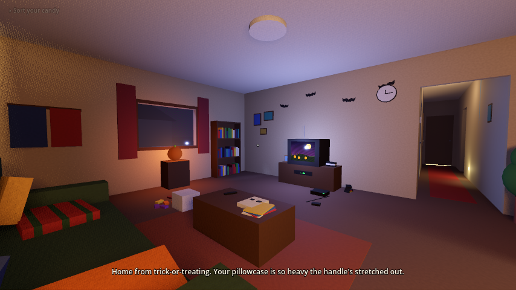
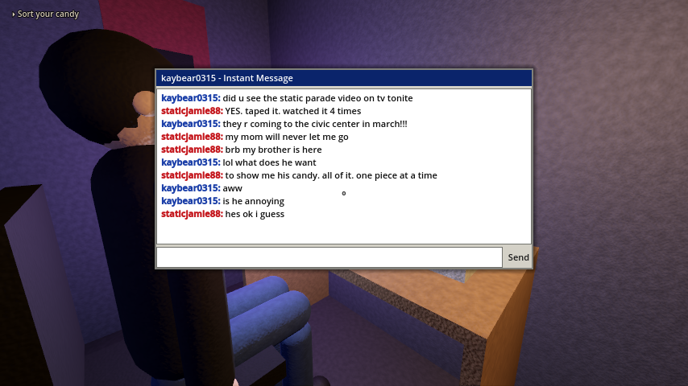
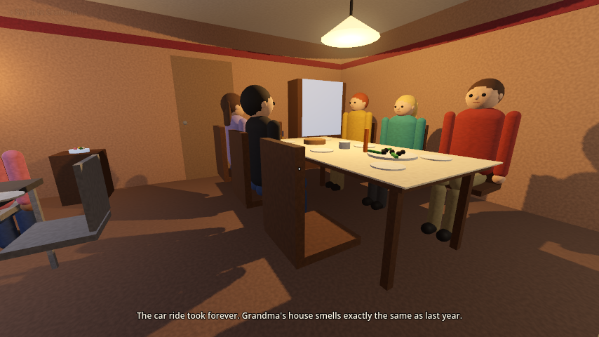
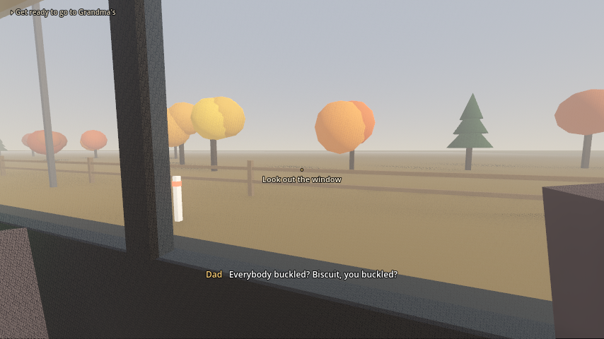
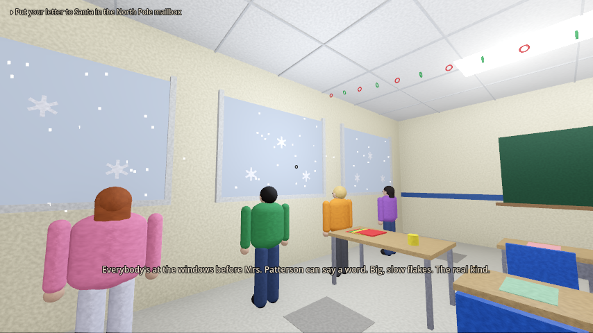
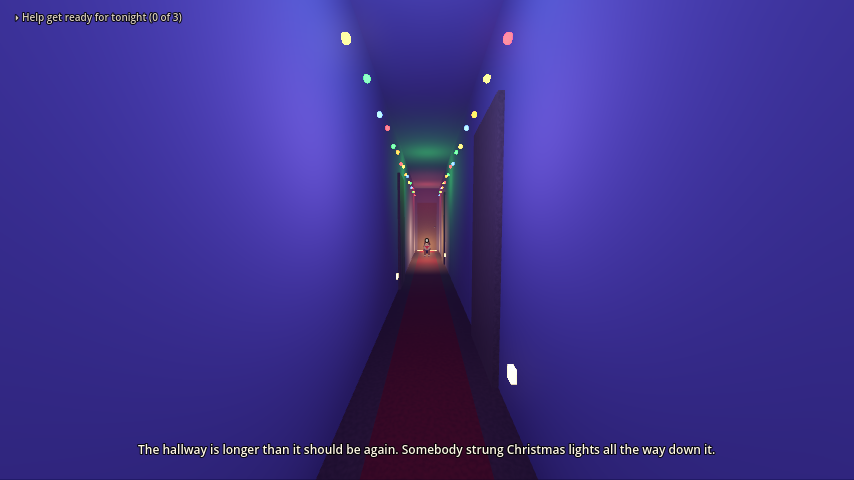
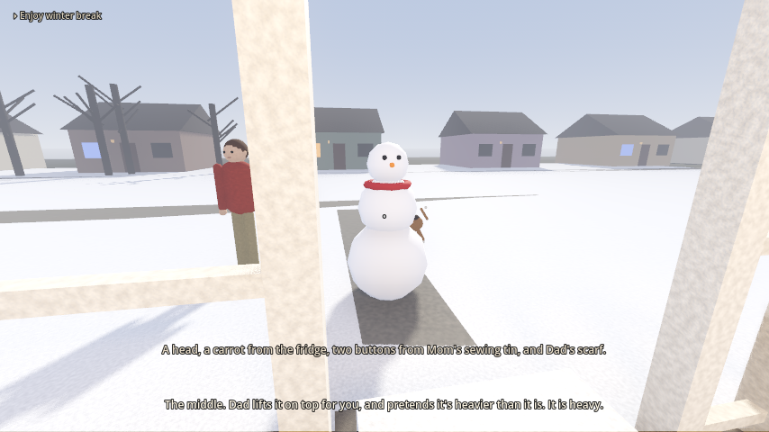
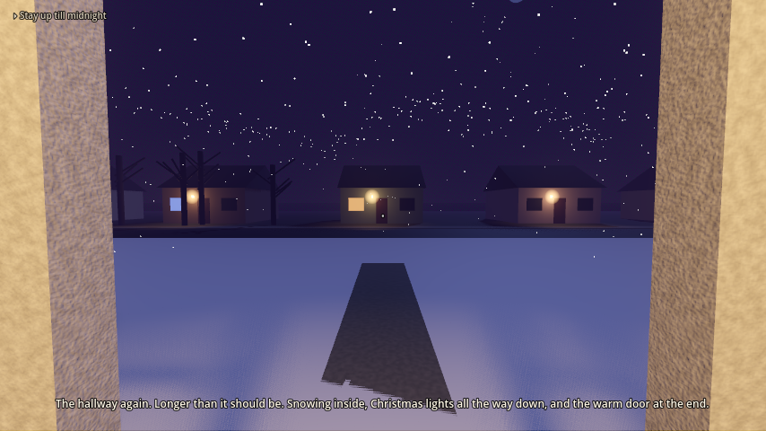
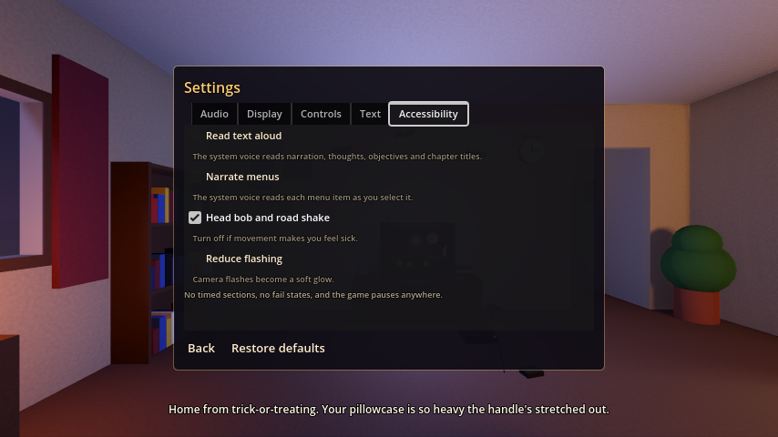

# Porch Lights

**A short, first-person story game about being a kid in the early 2000s, from Halloween to
New Year's Eve.**

You play Leo, an 8-year-old. Your older brother Jamie is 15 and has a band poster on every
wall, Mom and Dad are doing their best, Biscuit is a very good dog, and Grandma brings the
fudge. There's no combat, no timer and no way to lose. You walk around familiar places, pick
things up, listen to your family, and live through one holiday season: candy taxes, the kids'
table, the class party, untangling the lights, matching pajamas, the countdown, and the porch
light you leave on so everyone can find their way home.

**Download, play, leave feedback, or support the game:** <https://aidanbuilds.itch.io/porch-lights>



| | |
|---|---|
|  |  |
|  |  |
|  |  |
|  |  |

---

## For players

### What the game is
- **Genre:** first-person story exploration, in the spirit of *Gone Home*. A cozy holiday story, not a horror game.
- **Length:** seven chapters, from October 31 to December 31, plus a short Halloween night interlude.
- **Setting:** an American suburb in the early 2000s: CRT TVs, VHS tapes, instant messages, portable CD players, disposable cameras.
- **Look:** polished low-poly with warm lamp light, and dreams in deep blues and purples.
- **Status:** an in-development build for testing and feedback. See [Known issues](#known-issues).

### What you can do
- **Explore** the family house, Grandma's house, the family minivan, and Mrs. Patterson's third-grade classroom.
- **Look at and pick up things** that tell you about the family: photos, toys, Jamie's computer, the advent calendar, the toy catalog with page 47 folded down.
- **Talk to people.** Mom, Dad, Jamie, Grandma, cousins, classmates and the teacher all have things to say, and they say different things as the day goes on.
- **Do the holiday things:** sort your candy, open the cranberry sauce, pass out cupcakes, decorate cookies, wrap presents, find the one dead bulb on the tree, build a snowman, stay up for the countdown.
- **Spend time with Biscuit.** He follows you around, naps, rides along in the van, and shows up in your dreams.
- **Change the station** on the kitchen radio: spooky classics on Halloween, carols at Christmas. In the van, ask Dad to change it: the parade, the classical station, static.
- **Look around a lived-in 2003:** the VCR blinking 12:00, the answering machine, the free internet CD that comes in the mail every week, Jamie's Discman and burned CDs, Leo's virtual pet, Grandma's rotary phone and her console TV in the wood-paneled den.
- **Collect photos.** Whenever someone pulls out a disposable camera, the picture really gets taken. Your prints "come back from the drugstore" at the end, and you can look at them any time in the **Photo Album**.

Objectives in the top-left corner always tell you the next step, but you're never rushed. Wander, poke around and listen.

### Getting the game
1. Go to **<https://aidanbuilds.itch.io/porch-lights>** and download the version for your computer.
2. Unzip it and run **Porch Lights**.
   - **macOS** (one universal build for Intel and Apple Silicon): the game isn't notarized by Apple yet, so the first time macOS will say it "can't be opened". Click **Done**, open **System Settings → Privacy & Security**, scroll down, and click **Open Anyway** next to Porch Lights. You only need to do this once. (On older macOS, right-click the app and choose **Open** instead. Installing with the [itch.io app](https://itch.io/app) avoids the warning entirely.)
   - **Windows:** if SmartScreen appears, choose **More info**, then **Run anyway**.

**System requirements:** a computer with graphics that support Vulkan (Windows/Linux) or Metal (Mac), which covers most computers from roughly the last eight years. Keyboard and mouse, or a controller.

### Controls

| | Keyboard and mouse | Controller |
|---|---|---|
| Move | WASD / arrow keys | Left stick |
| Look around | Mouse | Right stick |
| Interact / talk / pick up | E or left click | A (or X) |
| Run | Shift | Click left stick (or LB) |
| Crouch | C or Ctrl | B (or click right stick) |
| Pause menu | Esc | Start (B closes it) |

Menus work with the mouse, the arrow keys, or the D-pad and left stick: A or Enter chooses, B or Esc goes back. Xbox, PlayStation and Switch Pro controllers work (they use the same button positions as the Xbox names above). Run and crouch can be set to **toggle** instead of hold.

### The menus
- **Title screen:** Continue, New Game, Chapters (replay any chapter you've reached), Photo Album, Settings, **Feedback & Support** (opens the itch.io page), Quit.
- **Pause menu (Esc / Start):** Resume, Settings, Photo Album, Main Menu, Quit.

### Settings and accessibility
Everything is in **Settings**, from the title screen or the pause menu, and takes effect right away.

| Tab | Options |
|---|---|
| **Audio** | Master, music, voices and sound-effects volume; **mono audio** (both channels in both ears) |
| **Display** | Fullscreen; **field of view** (60–100); crosshair on/off |
| **Controls** | Look sensitivity (mouse and right stick); **invert look**; **toggle run**; **toggle crouch** |
| **Text** | Subtitles for spoken lines; **text size** (Small, Medium, Large, Extra large); **background behind text**; **sound captions** ("[Phone ringing]", "[Biscuit barks]"); **how long text stays on screen** |
| **Accessibility** | **Read text aloud** (narration, Leo's thoughts, objectives and chapter titles, in your computer's voice); **narrate menus**; **head bob and road shake** on/off; **reduce flashing** |

**Restore defaults** resets everything.

Also built in:
- **No timed sections, no quick-time events, no fail states.** You can pause anywhere.
- **Every spoken line has subtitles.** Leo's thoughts and the narration are always on screen.
- **Nothing depends on color alone.** Prompts are written out.
- **Photosensitivity:** there are a few camera flashes (a quick white fade). Turn on **Reduce flashing** to make them a soft glow. There's no strobing.

**Content:** suitable for all ages. The dream sequences are a little eerie (long hallways, odd lighting) but never scary, and there's no violence, danger or bad language. The parents' worry about Grandma is quiet and gentle.

### Saving
Everything saves automatically: progress each time you reach a new chapter, photos as they're taken, and settings when you leave the Settings screen. Chapters you've reached stay unlocked under **Chapters**. Your save is kept here:

- **macOS:** `~/Library/Application Support/Godot/app_userdata/Porch Lights/`
- **Windows:** `%APPDATA%\Godot\app_userdata\Porch Lights\`
- **Linux:** `~/.local/share/godot/app_userdata/Porch Lights/`

To start completely fresh, use **New Game** (or delete that folder).

### Feedback, bugs and support
This build exists to get feedback, so tell me what you think. Leave a comment on **<https://aidanbuilds.itch.io/porch-lights>**, or use the **Feedback & Support** button on the title screen. Helpful details:
- what chapter you were in and what you were doing,
- what happened, and what you expected,
- your computer (Windows/Mac/Linux) and whether you used a controller,
- a screenshot if something looks wrong.

The game is free to play. If you enjoyed it and want to support development, you can leave a donation on the itch.io page. Thank you!

### Known issues
This is a work in progress:
- **Voices** are generated with free text-to-speech as placeholders. The kids are adult voices pitched up.
- **Some music** is placeholder: Grandma's house, the drive home, the class party, the snow dream and Jamie's band Static Parade are stand-in tracks until the real ones are recorded.
- **The football game** on Grandma's TV is a simple drawn picture.
- **Saves from earlier test builds** may resume at the wrong chapter, because the chapter order changed. Start a **New Game**.
- Things can still be placed a little oddly, or a line can trigger at a strange moment. Please report anything like that.

<details>
<summary><b>The chapters (spoilers)</b></summary>

**Chapter 1: October 31, Halloween.** Sort your candy. Pay the candy tax (and catch Mom and
Dad plotting to keep the full-size bars). Turn off the porch light and watch the rest of the
street go dark one house at a time. Show Jamie your haul, read over their shoulder while they
instant-message a friend about you ("hes ok i guess"), and hang out in their room until Mom
calls bedtime. Fall asleep, and the hallway keeps going, Biscuit waiting at the end by a warm
door that smells like Grandma's kitchen.

**Interlude: 2:14 a.m., The Midnight Candy Raid.** A crinkle wakes you. Jamie heard it too.
Flashlight in hand, you catch Mom and Dad in the kitchen eating your Halloween candy. Everybody
gets one. Then Biscuit needs to go out, and from the porch you watch the neighborhood's porch
lights click off one by one.

**Chapter 2: November, Thanksgiving.**
*Getting Ready:* get Biscuit's leash (he comes running) while Mom guards the pies, Dad warms
up the van and Jamie protests the hour from the couch. Then the drive: autumn trees, the parade on
the radio, and "over the river..." ("Every. Single. Year.").
*At Grandma's:* open the canned cranberry sauce (ridges and all), football on the TV cart, and
the kids' table while Jamie moves up to the big table. After dinner, Mom and Dad quietly notice
Grandma's moving slower this year, and Grandma saves you the first slice of pie.
*The Drive Home:* leftovers on your lap, Biscuit's head on your lap too, streetlights sliding
over the ceiling. Jamie lends you one earbud: Static Parade. Mom and Dad talk low about
Grandma. The first Christmas song of the year comes on the radio, and the first snow starts
falling in the headlights as you fall asleep.

**Chapter 3: December 19, The Last Day Before Winter Break.** Mrs. Patterson's third grade.
Letters to the North Pole, paper snowflakes, Secret Santa (a mood ring!), passing out the
cupcakes with the crunchy sprinkles, the claymation special on the TV cart... until Josh yells
"IT'S SNOWING!" and everybody runs to the windows. After the bell, you wait on the hallway bench
for Mom while the school empties out, and you dream of the hallway stretching on, snow falling
indoors, Biscuit by a door glowing with Christmas lights. *To be continued. Next: Christmas Eve.*

**Chapter 4: December 24, Christmas Eve.** Decorate sugar cookies with Mom, wrap Grandma's
present with Dad (way too much tape), and help Jamie find the one dead bulb so the whole tree
lights up. Grandma arrives with fudge. Matching reindeer pajamas, the family picture, dinner and
the claymation special, cookies and milk for Santa, carrots for the reindeer, and the porch
light on so Santa can find the house.

**Chapter 5: December 25, Christmas Morning.** 5:52 a.m., still dark. He came! The stockings,
the Mega Robo Racer (Grandma brought batteries), the sun coming up over the snow, Dad's snowman
pancakes, and a snowball ambush from Jamie.

**Chapter 6: December 28, Winter Break.** No school, no hurry. Hot chocolate, Grandma's
thank-you note, player two on Jamie's new game, a snowman in the front yard while Biscuit runs
laps in the snow, and a board game with missing pieces.

**Chapter 7: December 31, New Year's Eve.** You're allowed to stay up till midnight. The
ornaments, the snacks, Grandma calling early, the countdown on TV, the last picture on the roll.
Then the house goes quiet, and one last dream brings it all together, out onto the porch where
every light on the street is glowing.

</details>

### Credits
- **Made by** Aidan Vazquez, with Claude Code.
- **Engine:** [Godot](https://godotengine.org) 4.3.
- **Voices:** [Kokoro-82M](https://huggingface.co/hexgrad/Kokoro-82M) text-to-speech (Apache-2.0).
- **Sound effects and some music:** CC0 recordings from BigSoundBank, Kenney and OpenGameArt.
- **Holiday songs:** public-domain compositions (traditional carols, Grieg, Bach, "Auld Lang Syne"), arranged for the game.
- Full list in [`audio/CREDITS.md`](audio/CREDITS.md).

---

## For developers

### Run from source
Install **Godot 4.3+**, then **Import** and select `project.godot`, and press **F5**. On a Mac
without Godot on your PATH, you can also run:
```
~/Downloads/Godot.app/Contents/MacOS/Godot --path .
```

### Project layout
- `scenes/`: one scene per chapter part, in story order in `Game.CHAPTERS` (`scripts/game.gd`).
  The interlude plays in the Chapter 1 house. Getting Ready, Christmas Eve, Christmas Morning,
  Winter Break (`winter_break_days`) and New Year's Eve inherit that house and redecorate it in
  code (`scripts/house_chapter.gd`, `scripts/decorations.gd`).
- `scripts/chapter.gd`: base class for chapters: `say()` dialogue (voiced automatically),
  `objective()`, `open_chapter()` title cards, `add_chatter()`, room-state swapping.
- `scripts/chapter_*.gd`, `scripts/interlude_porch_light.gd`, `scripts/school_class_party.gd`,
  `scripts/winter_break_days.gd`: the story steps.
- `scripts/game.gd`: autoload `Game`: chapter order, saves, **settings**, photo album, pause, text-to-speech.
- `scripts/controls.gd`: every input action, keyboard/mouse and controller.
- `scripts/ui.gd`, `scripts/main_menu.gd`, `scripts/pause_menu.gd`: menus, the tabbed settings, the album.
- `scripts/hud.gd`: thoughts, dialogue, sound captions, objective, fades, chapter cards (follows the text settings).
- `scripts/player.gd`: Leo's kid-height first-person controller.
- `scripts/interactable.gd`: attach to any StaticBody3D; set `prompt`, `memory_text`, `repeat_text`, `use_sfx`, or connect to `used`.
- `scripts/dog.gd`: Biscuit. `scripts/figure.gd`: people built in code.
- `scripts/car_ride.gd`: the family minivan, day or night, with the road sliding past.
- `scripts/street.gd`: the neighborhood. `scripts/classroom.gd`, `scripts/school_hallway.gd`: the school.
- `scripts/living_room_details.gd`: the lived-in clutter. `scripts/radio.gd`: the kitchen radio.
- `scripts/im_window.gd`: the instant-message window.
- `scripts/tv_screen.gd`, `scripts/tv_show.gd`: the live TV picture. Drop an Ogg Theora video at
  `media/<channel>.ogv` (`special`, `commercial`, `winter`, `christmas`, `football`, `newyear`, `dream`, `signoff`, `static`) to use real footage.
- `scripts/look.gd`: the low-poly polish pass (round shapes, subtle surface grain, soft shadows, rounded people).
- `scripts/audio.gd`: autoload `Audio`: music, sound effects, voices, sound captions.

Rendering is 854×480 (480p, the PS2/DVD era) with MSAA, soft shadows, SSAO/SSIL and volumetric fog.

### Building for itch.io
```
sh tools/build.sh             # Mac, Windows and Linux zips in builds/
sh tools/build.sh Windows     # just one
```
Needs Godot 4.3's export templates (**Editor → Manage Export Templates → Download**). The presets
are in `export_presets.cfg`: Mac is a universal build with an ad-hoc signature (not notarized);
Windows and Linux are x86_64 with the game data embedded in the executable. `tests/`, `tools/`,
`docs/` and `screenshots/` are left out of the builds. There's no web build: the game uses
Godot's Forward+ renderer (soft shadows, fog, SSAO), which doesn't run in browsers. Upload each zip
to itch.io and mark its platform, or push with [butler](https://itch.io/docs/butler/).

### Trailer
```
~/Downloads/Godot.app/Contents/MacOS/Godot --path . --resolution 1280x720 \
    --fixed-fps 30 --write-movie builds/trailer.avi -s res://tools/trailer.gd
```
Records a ~55-second trailer with Godot's Movie Maker (`tools/trailer.gd`): ten shots across
the chapters with slow camera moves, title cards and the closing music, ending on the title and
the itch.io link. The output is MJPEG AVI, which YouTube accepts directly.

### Audio tools
- **Voices:** every character line is voiced with Kokoro, offline and free. Run
  `python tools/generate_voices.py --setup` once, then `python tools/generate_voices.py` records any
  new or changed lines (`--force` re-records all, `--prune` removes unused ones, `--list` shows every
  line and its file name). Casting is `SPEAKERS` in that script; kid pitch is `PITCH` in `scripts/audio.gd`.
- **Music:** `python tools/compose_music.py` composes the stand-in themes and arranges the public-domain
  radio songs. `python tools/fetch_audio.py` rebuilds the CC0 recordings. `python tools/generate_audio.py`
  makes the electronic sounds (TV jingles, crowd loops, chimes).
- **Replacing anything:** drop a `.wav`, `.ogg` or `.mp3` with the same name into `audio/voice/`,
  `audio/music/` or `audio/sfx/`, and delete the generated `.wav` so it isn't shadowed.

### Tests
Automated playthroughs; each prints the story states it reaches:
```
godot --headless -s res://tests/playtest_chapter_1.gd              # Halloween + the interlude
godot --headless -s res://tests/playtest_chapter_2_getting_ready.gd
godot --headless -s res://tests/playtest_chapter_2.gd              # At Grandma's
godot --headless -s res://tests/playtest_chapter_3.gd              # The drive home
godot --headless -s res://tests/playtest_school.gd
godot --headless -s res://tests/playtest_chapter_5.gd              # Christmas Eve
godot --headless -s res://tests/playtest_chapter_6.gd              # Christmas Morning
godot --headless -s res://tests/playtest_winter_break.gd
godot --headless -s res://tests/playtest_chapter_7.gd              # New Year's Eve
godot --headless -s res://tests/playtest_controller.gd             # sticks, buttons, pause menu
godot --headless -s res://tests/playtest_settings.gd               # accessibility and settings
godot --headless -s res://tests/playtest_paths.gd                  # nobody blocks the hallway
```
`tests/screenshots.gd` renders screenshots (needs a window, not `--headless`).
